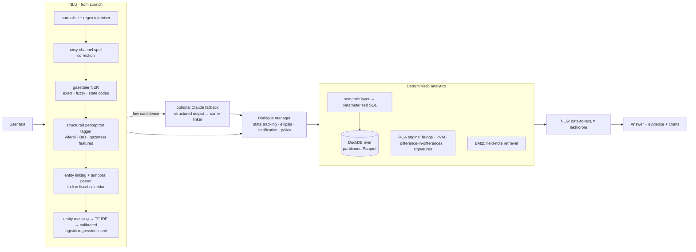

# 🕵️ Sherlock Rx

[](https://github.com/akshitsubudhi/Sherlock-Rx/actions/workflows/ci.yml)

**A conversational NLP assistant that finds *why* a pharma brand is under-performing in a region, and shows its evidence.**

> *Brand Root Cause Analysis: a conversational AI solution to perform root cause analysis for
> under-performing brands by region (Healthcare).*

Ask it *"Which brands are underperforming in the South this quarter?"*, then *"why?"*, then
*"which territories are dragging it down?"*, then *"what should we do?"*. Sherlock Rx answers
with the root cause, the evidence, the territories responsible, field reports that corroborate
it, and an action plan. Every number comes from a deterministic analytics engine; no number
is ever generated by a language model.

The NLP is built from fundamentals: tokenisation, spelling correction, TF-IDF, Naive Bayes,
a structured-perceptron sequence tagger with Viterbi decoding, entity linking, temporal
expression normalisation, BM25 retrieval, dialogue state tracking and template NLG.
Each component is implemented from scratch, tested against a reference implementation where
one exists, and measured. An LLM (Claude) is an *optional* fallback for low-confidence
utterances, and its output is forced back through the same entity linker.

| | |
|---|---|
| **Root-cause accuracy** | **98.8%** top-1 over 160 planted scenarios (5 seeds), 100% location accuracy, **0%** false alarms on 100 control cells |
| **NLU accuracy** | **93.4%** intent / **100%** slot accuracy on a hand-written test set written *after* the model was frozen (keyword-rule baseline 60.5%) |
| **Dialogue** | 13/13 scripted multi-turn conversations (31 turns) pass: follow-ups, ellipsis, clarification, carry-over |
| **Scale** | 7.6M sales rows (30.6M rows total) on a laptop: chat turn p50 **36 ms**, cold root-cause analysis p50 **253 ms** |
| **Latency** | NLU **0.6 ms** per utterance; full chat turn p50 11 ms at default scale |
| **Engineering** | 71 tests incl. acceptance gates; `ruff` + `mypy --strict` clean; CI retrains from scratch |

All numbers are produced by `make eval` and `make bench` → [`reports/EVAL.md`](reports/EVAL.md),
[`reports/BENCH.md`](reports/BENCH.md), [`reports/nlu_report.md`](reports/nlu_report.md).

---

## A real conversation

Output from the bot, trimmed for length; the bracketed line is the debug trace.

```text
you> Which brands are underperforming in the South this quarter?
     [intent=find_underperformers conf=0.99 policy=classifier 25 ms]
| # | Brand      | Region | Achievement | YoY   | vs rest of India | Status          |
| 1 | Cefobact   | South  | 83.6%       | -6.0% | -1.6% pts        | Underperforming |
| 2 | Neurovita  | South  | 82.3%       | -2.6% | -1.2% pts        | Underperforming |
| 3 | Gastrazole | South  | 86.6%       | +9.4% | +3.2% pts        | Underperforming |
The most urgent is Cefobact in South. Ask "why?" and I'll run a root-cause analysis on it.

you> why?                                   [intent=diagnose conf=1.00 107 ms]
Cefobact · South · Q2 FY27: 🔴 Underperforming
Sales ₹15.19 Cr vs target ₹18.16 Cr (83.6% achievement), -6.0% YoY against -4.9% for the rest of India.
Most likely root cause: Price reduction (NPPA / DPCO) (High confidence).
Impact ≈ -₹1.84 Cr (-11.4% of last year's sales), concentrated in Cefobact 200.
- Realised price of Cefobact 200 changed -16.6% YoY while units moved +5.4%.
- Price effect elsewhere in India: -11.6% of sales (same cut nationally).
Offsets: market growth +₹1.00 Cr.
Suggested action: Value loss is regulatory; protect margin through mix and reset the value target.
Method: YoY bridge + territory difference-in-differences · 7 queries · 80 ms
```

The planted ground truth for that cell is an NPPA ceiling-price cut on Cefobact 200, so the
diagnosis can be checked. Checkable answers are the point of the project (see *Evaluation* below).

<details><summary>Other things it understands</summary>

```text
why is gluco down in UP in Q1          → truncated brand recovered by the tagger, "UP" as a state code,
                                          "Q1" resolved to Q1 FY27 (Apr–Jun 2026)
Cardivx is underperformng in Karnatka  → spell-corrected + fuzzy-linked
Respiron East mein kyun gir raha hai?  → Hinglish
what about South? / and Kerala?        → ellipsis: repeat last task with the new slot
diagnose → "Which brand?" → Respiron   → clarification resumes the pending intent
what's the weather in Delhi?           → out of scope, and "Delhi" does not leak into state
what is DPCO?                          → BM25 over a domain glossary
any field reports?                     → BM25 over ~860 MR/ABM notes, filtered to the case
```
</details>

## How it works



* **NLU** turns text into `(intent, slots)`. User text never becomes SQL; it is linked to
  known dimension members and reaches the database only as bound parameters.
* **Dialogue manager** keeps a frame of slots across turns and decides what to do: resolve
  "what about South?", ask for a missing brand, default a missing period (and *say so*).
* **RCA engine** decomposes last year → this period into market growth, share change and
  price. It then attributes the share change to field-force vacancies, stock-outs,
  distribution loss and competitors, using territory-level difference-in-differences against
  untreated territories nationally. Each cause carries an INR impact, a confidence score,
  locations and the evidence sentences shown in the answer. → [docs/RCA_METHOD.md](docs/RCA_METHOD.md)
* **Data**: a synthetic but *causal* model of an Indian formulations business: 8 brands, 20
  states in 5 zones, 113–11,340 territories, 42 months, April–March fiscal year. Root causes
  are *planted* (6 types, known location and severity), so accuracy can be measured.
  → [docs/ARCHITECTURE.md](docs/ARCHITECTURE.md)

## NLP fundamentals covered

| Concept | Implementation | How it is verified |
|---|---|---|
| Normalisation & tokenisation | regex tokeniser keeping `Q2`, `FY27`, `₹12,000`, `3.5%`, with char offsets | unit tests |
| Stemming | Harman S-stemmer + conservative suffix rules | unit tests |
| Spelling correction | Norvig noisy channel, edit distance 1–2, domain unigram LM | unit tests (incl. "leave valid words alone") |
| Bag-of-words / TF-IDF | word 1–2-grams + char 3–5-grams, smoothed IDF, sublinear TF, L2 | **matches scikit-learn to 1e-9** |
| Naive Bayes | multinomial, Laplace smoothing, log space, log-sum-exp | **matches scikit-learn to 1e-10** |
| Linear classifiers | logistic regression / linear SVM on our TF-IDF | template-held-out F1 |
| Probability calibration | expected calibration error; selection requires ECE ≤ 0.15 | `reports/nlu_report.md` |
| Sequence labelling (NER) | averaged structured perceptron, Viterbi, BIO-constrained transitions | entity-level P/R/F1, ablation |
| Gazetteers & fuzzy matching | n-gram dictionary lookup, Levenshtein ratio, leftmost-longest | unit tests |
| Entity linking | type-restricted fuzzy + prefix linking to canonical IDs | slot accuracy |
| Temporal expressions | rule grammar → normalised periods (Indian FY, "last 3 months", "since June") | 22 parametrised tests |
| Information retrieval | Okapi BM25, inverted index, metadata filters, query expansion | ranking tests |
| Data augmentation | template grammar, EDA synonym replacement, keyboard-typo noise, Hinglish | template-split evaluation |
| Dialogue state tracking | slot frame with hierarchical geography resets and carry-over | 13 scripted conversations |
| Dialogue policy | ellipsis, anaphora, clarification with pending frames, confidence gate | dialogue tests |
| NLG | data-to-text templates, Indian digit grouping (₹1,23,45,678 / ₹1.23 Cr) | faithfulness test |
| Evaluation methodology | splits *by template*, a frozen hand-written held-out set, baselines, ablations | [docs/EVALUATION.md](docs/EVALUATION.md) |

Ablations from the training report (template-held-out test split):

| | F1 |
|---|---|
| NER: gazetteer only / perceptron only / **perceptron + gazetteer features** | 0.896 / 0.924 / **0.967** |
| Intent: keyword rules / Naive Bayes / **TF-IDF + LogReg** (selected for calibration) | 0.452 / 0.657 / 0.610 |
| Intent: TF-IDF + LogReg **without** entity masking | 0.588 |

## Evaluation

The generator plants 32 root causes per seed. Each perturbs one lever (rep vacancy, stock-out,
competitor entrant, NPPA price cut, category slowdown, distribution loss) for one brand in one
region and quarter. It does this through a causal chain (calls → Rx share → prescriptions →
sell-out → secondary sales × price), so each cause produces its *natural signature*. For
example, a stock-out lowers sales but not prescriptions. Placement rules stop scenarios
contaminating each other's prior-year baselines.

| Cause severity | Noise | Top-1 cause | Location | False alarms |
|---|---|---|---|---|
| ×1.0 (default, 5 seeds) | ×1 | **98.8%** | 100% | 0.0% |
| ×0.5 | ×1 | 95.8% | 100% | 0.0% |
| ×0.35 | ×1 | 88.5% | 100% | 0.0% |
| ×0.5 | ×2 | 90.6% | 100% | 1.7% |

NLU is evaluated three ways, and the last is the most honest:
1. a template-held-out test split (phrasings never seen in training): macro-F1 0.61–0.66;
2. hand-written set v1 (132 utterances, used during development): 97.7%;
3. **hand-written set v2 (76 utterances, written after the model was frozen, scored once): 93.4% intent, 100% slots.**

Details, failure lists and what changed between rounds → [docs/EVALUATION.md](docs/EVALUATION.md)
and [docs/DECISIONS.md](docs/DECISIONS.md).

## Scale

Measured with `make bench` on an 8-core, 8.6 GB laptop:

| Scale | Territories | Sales rows | All rows | Generate | RCA cold p50 | Chat turn p50 | RCA/s, 4 processes |
|---|---|---|---|---|---|---|---|
| ×1 | 113 | 76k | 0.33M | 0.2 s | 68 ms | 10 ms | 51.4 |
| ×10 | 1,134 | 762k | 3.1M | 1.4 s | 109 ms | 12 ms | 24.5 |
| ×50 | 5,670 | 3.8M | 15.3M | 7.1 s | 203 ms | 30 ms | 13.9 |
| ×100 | 11,340 | 7.6M | 30.6M | 14.5 s | 253 ms | 36 ms | 8.2 |

What the benchmark taught (each finding changed the code; see [docs/SCALING.md](docs/SCALING.md)):
* **Threads don't help; processes do.** The RCA maths is pandas (GIL-bound), so 8 threads are
  *slower* than 1, while 4 processes give 3× at ×1. The API scales with uvicorn workers.
* **DuckDB oversubscription.** Each process defaults to all cores. Capping threads per worker
  (cores ÷ workers) raised ×50 throughput from 9.6 to 13.0 RCA/s.
* **An optimisation that measured worse was removed.** An in-memory roll-up table was no
  faster than scanning Parquet (272 vs 264 ms) and cost a copy per worker. Without it, 4
  processes at ×100 went from 5.0 to 8.1 RCA/s.
* **Lazy index build.** The first diagnosis at ×50 took 1.3 s because the BM25 index over 28k
  field notes was built on demand. It is now built at start-up (1.1 s, once).

Moving to production is mostly configuration: the semantic layer emits ANSI SQL that
`sqlglot` transpiles to Snowflake/BigQuery/Databricks, sessions are picklable (swap the
in-memory store for Redis), and the API is stateless.

## Quick start

```bash
git clone https://github.com/akshitsubudhi/Sherlock-Rx.git && cd Sherlock-Rx
make setup        # venv + deps, generate data (0.2 s), train NLU (~90 s)
make chat         # terminal chat with the NLU trace
make ui           # Streamlit app: chat + "under the hood" panel + charts
make api          # FastAPI on :8000  (POST /v1/chat, /v1/rca, /v1/nlu · GET /metrics)
make test         # 71 tests incl. acceptance gates
make eval bench   # regenerate reports/
```

Optional LLM fallback: `export ANTHROPIC_API_KEY=...` then `sherlock chat --llm` (model
`claude-opus-5-5`, structured outputs, low effort). Without a key everything works; the
fallback is tested with a mocked client. A `Dockerfile` and `docker-compose.yml` (API + UI)
are included; they were not run in the development environment.

## Repository layout

```
src/sherlock_rx/
  data/        catalog, Indian fiscal calendar, causal generator, planted scenarios, field notes
  warehouse/   DuckDB engine (thread-local cursors, query log, LRU cache), YAML semantic layer
  analytics/   RCA engine, metric / trend / compare / scan services
  nlp/         text, spell, vectorize, naive_bayes, gazetteer, tagger, temporal, ner, intent,
               retrieval (BM25), templates + corpus builder, train, pipeline, llm_fallback
  dialogue/    state tracking, dialogue manager (policy), NLG
  api/         FastAPI service, session store, metrics
  ui/          Streamlit app
  eval/        RCA, NLU and dialogue evaluations, scale benchmark, report writer
tests/         unit tests, acceptance gates, hand-written NLU sets, scripted dialogues
reports/       generated evaluation and benchmark reports
docs/          architecture, RCA method, evaluation, scaling, decision log, resume notes
```

## Limitations

* **The data is synthetic.** Planted signals are cleaner than real field data; the robustness
  sweep shows how accuracy degrades as signals weaken. Brands and competitors are fictional;
  molecules, states and the fiscal calendar are real. Not affiliated with any company.
* **The RCA explains changes, not chronic gaps.** It decomposes *year-on-year* movement. A
  brand that has been below plan since a competitor launched 18 months ago shows up as "a gap
  against plan, not a deterioration". A plan-vs-actual decomposition is the next step.
* **Recommendations come from a playbook** keyed by cause. They are not learned from outcomes.
* **The NLU's held-out set is small** (76 utterances), so 93.4% carries a 95% interval of
  roughly ±6 points.

License: MIT.
